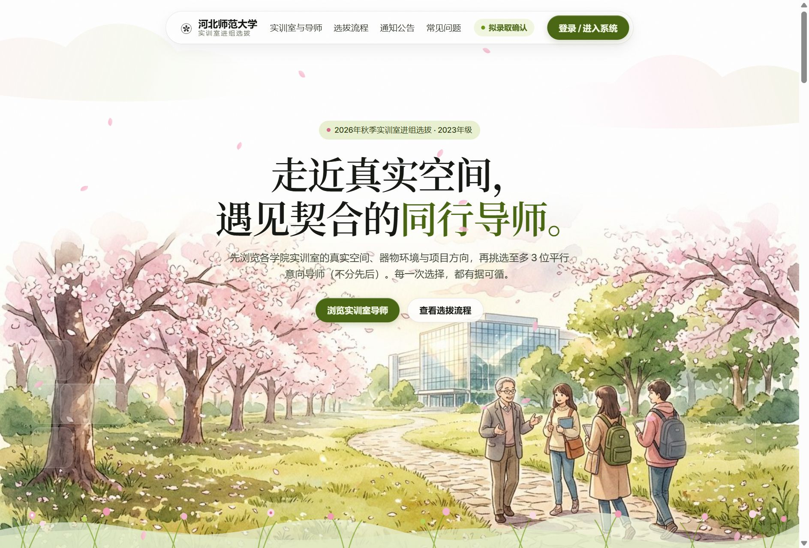
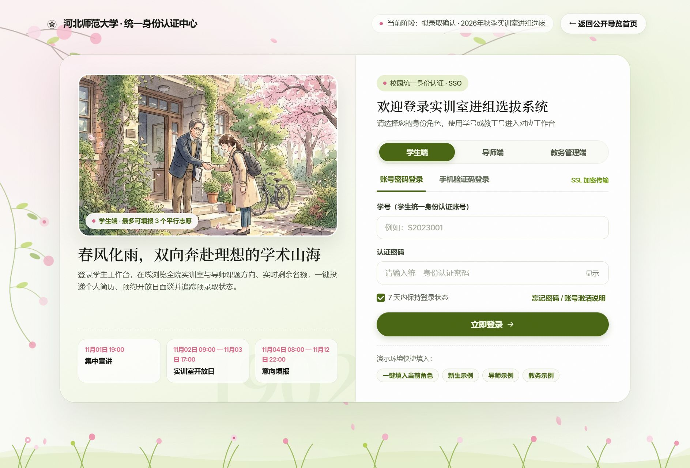
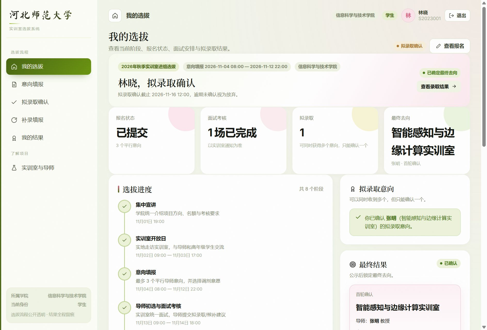
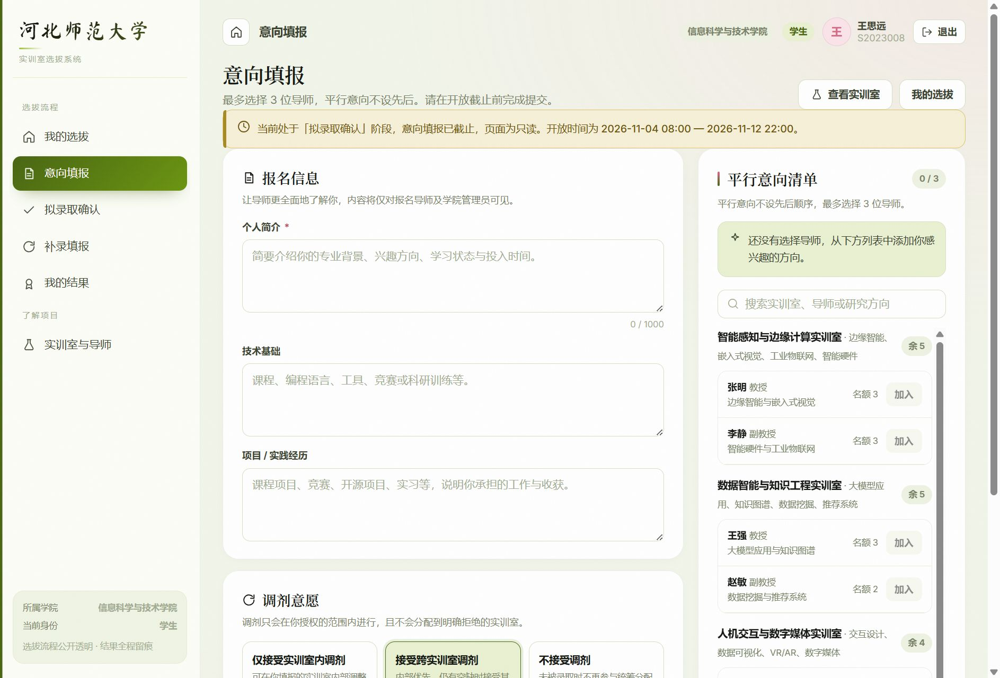
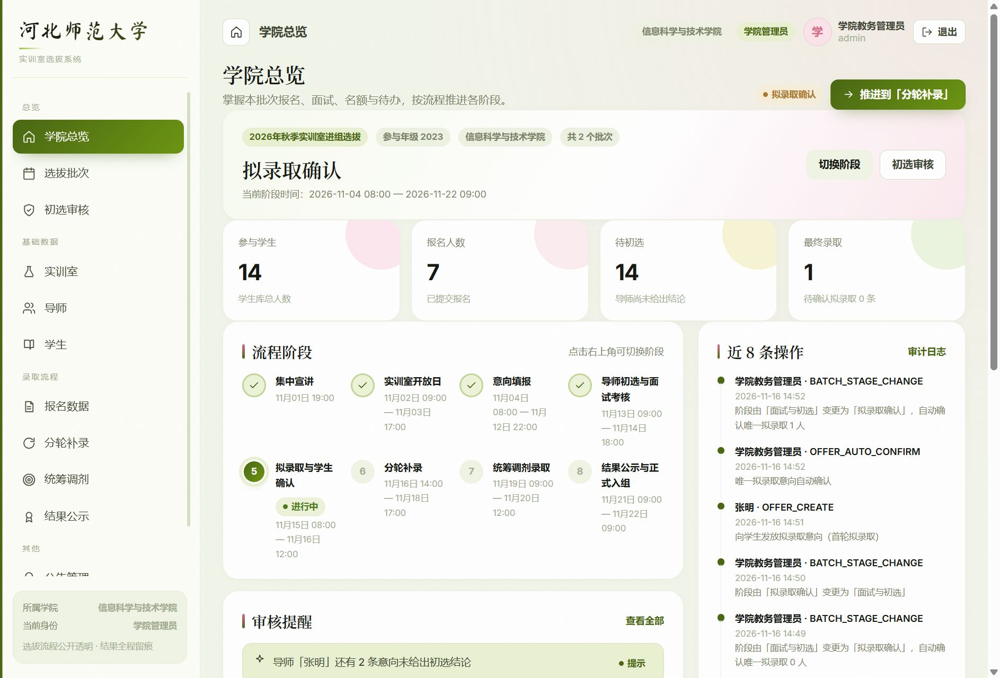
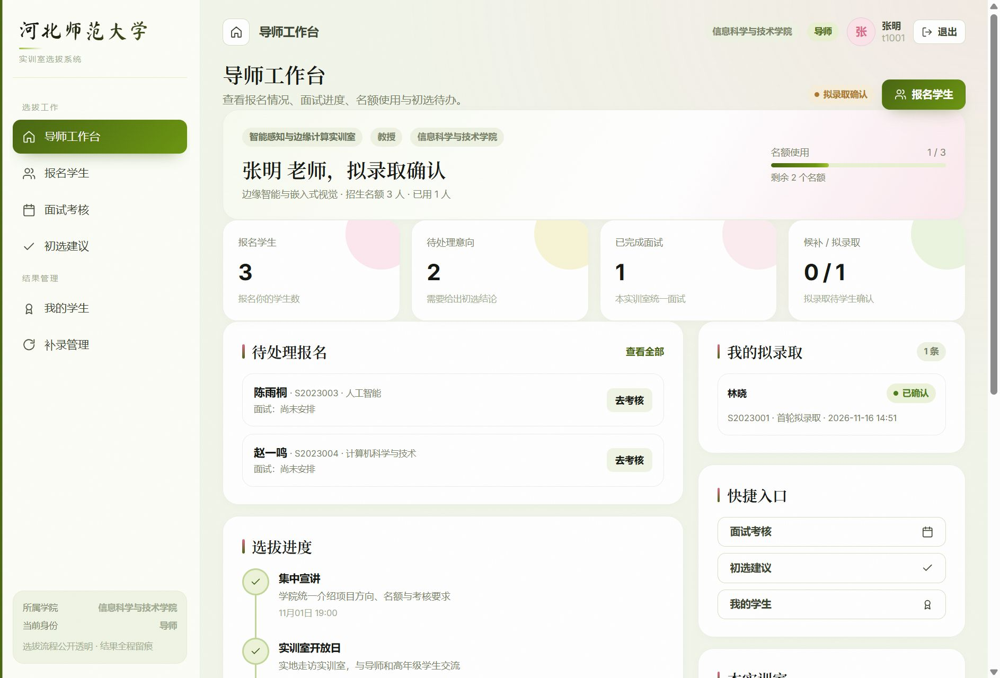

# 学生实训室进组选拔系统

> 双向选择 · 分轮录取 · 统筹调剂  
> Vue 3 + Vite + Axios ｜ Java 17 + Spring Boot 3 + MyBatis ｜ MySQL 8

一个面向全校多学院实训室、项目组、导师团队进组选拔的全流程系统。系统把“集中宣讲 → 开放日 → 平行意向 → 统一面试 → 导师初选 → 拟录取确认 → 分轮补录 → 统筹调剂 → 结果公示”串成可追溯的业务闭环，并重点解决：

- 学生最多填报 **3 个平行导师意向**，不设志愿先后；
- 导师拟录取受 **导师名额 + 实训室总名额** 双重约束；
- 一名学生可收到多个拟录取，但只能 **确认一个**；
- 放弃、逾期未确认产生的空缺进入 **候补递补 / 分轮补录**；
- 调剂按 **实训室内部 → 跨实训室 → 谈话安置** 的优先级，在授权范围内进行；
- 公示发布后 **锁定结果**，修改必须“撤回公示 → 修改 → 重新公示”；
- 报名、面试、拟录取、确认、补录、调剂、公示、阶段切换全程 **审计留痕**；
- 登录后按账号所属学院自动隔离，学生/导师/管理员 **只能看到本学院实训室**，游客可浏览全校；服务端强制过滤，而非前端隐藏。

项目融合了两个开源项目的优点，并针对课程大纲补齐了它们缺失的批次、阶段、面试、多意向、确认、补录、调剂、公示与审计能力。对比分析见 [docs/COMPARISON.md](docs/COMPARISON.md)。

---

## 页面预览

| 公开首页 | 登录页 |
| --- | --- |
|  |  |

| 学生工作台 | 意向填报 |
| --- | --- |
|  |  |

| 学院总览 | 导师工作台 |
| --- | --- |
|  |  |

更多页面截图见 [docs/screenshots](docs/screenshots)。

---

## 一、功能清单

### 游客 / 公开端

- 公开首页：全校实训室画廊、学院筛选、搜索、导师空间、8 步流程、公告、FAQ 式规则速览；
- 游客可浏览全部学院实训室；登录后自动切换为本学院范围。
- 实训室详情：简介、研究方向、培养安排、选拔要求、导师名单、名额与联系方式；
- 公示查询：仅当公示处于“公示中 / 已结束”时公开展示最终名单；
- 登录入口：三种角色切换（学生 / 导师 / 管理员），支持账号密码与验证码两种登录方式（验证码为演示入口），一键填充演示账号；

### 学生端

- 我的选拔：当前阶段、报名状态、面试安排、拟录取、最终去向、调剂记录；
- 实训室与导师：仅展示本学院实训室，支持搜索、封面画廊、查看详情、按方向选择导师；
- 意向填报：最多 3 个平行意向、个人简介/技术基础/项目经历、调剂意愿、明确拒绝的实训室；
- 截止前可保存草稿、修改、重新提交、撤回；截止后自动锁定；
- 拟录取确认：单一拟录取自动确认；多个拟录取须自主选择其一；可主动放弃或全部放弃；
- 补录填报：补录轮次内重新填报最多 3 个意向，并确认补录拟录取；
- 我的结果：最终录取、录取方式、公示信息、调剂记录、历史批次。

### 导师 / 实训室端

- 工作台：报名数、待处理、面试完成数、候补/拟录取、名额使用；
- 报名学生：按状态/关键词筛选，查看学生材料；
- 统一面试：安排时间地点、评分、评语、通过/不通过，同一实训室共享面试记录；
- 初选建议：拟录取 / 候补（含顺位）/ 不录取；拟录取受名额硬约束；
- 我的学生：最终确认进入名下的学生名单；
- 补录管理：对补录阶段填报的学生提交结论；
- **数据隔离**：导师端只展示本人意向，学生的其他平行意向只显示数量，不展示具体导师，避免影响独立评价。

### 学院管理端

- 学院总览：本学院批次、阶段、报名/待初选/录取统计、审核提醒、名额概览、最近审计；
- 选拔批次：批次名称、参与年级/专业、说明、规则、8 个阶段起止时间；
- 阶段推进：10 个状态自由切换，进入确认自动确认唯一拟录取、进入补录自动建轮次、进入公示尝试生成草稿；
- 初选审核：超额、缺面试、待确认、待处理等异常检查；自动确认、逾期处理；
- 实训室/导师/学生管理：仅限本学院，CRUD、名额、封面/位置、账号启停、重置密码；
- 报名数据：查看报名、平行意向、调剂授权、面试、拟录取与最终结果；
- 分轮补录：创建/开放/结束轮次，按候补顺位自动递补；
- 统筹调剂：一键自动调剂 + 手动调剂 + 谈话安置；
- 结果公示：草稿、发布、结束锁定、撤回重新公示；
- 公告管理：宣讲/开放日/面试/补录/公示通知；
- 操作审计：按批次、操作类型查询完整日志。

---

## 二、技术栈

| 层 | 选型 |
| --- | --- |
| 前端 | Vue 3（Composition API）、Vite 5、Vue Router 4、Pinia、Axios、原生 CSS 设计系统 |
| 后端 | Java 17、Spring Boot 3.2.5、Spring MVC、Bean Validation、MyBatis 3.0.3 |
| 数据库 | MySQL 8.0（utf8mb4 / InnoDB） |
| 鉴权 | PBKDF2-HMAC-SHA256 口令摘要 + 数据库不透明 Token（SHA-256 存储） |
| 构建 | Maven 3.10、npm |

界面采用日系水彩风格：公开端（游客首页 / 登录页）以奶油白为底、橄榄绿（#4a6714）与黄绿（#b9d458）为主色，配水彩插画、玻璃卡片、飘落花瓣与草地条装饰；内部三端（学生 / 导师 / 管理）沿用同一套水彩绿系配色（橄榄绿主色、奶油白背景、黄绿点缀），并以浅粉（#f5b8cb / #fbe9ee）适当平衡，与登录页视觉一致；品牌标识为黑线五瓣花圆环图标。

不引入 Redis、消息队列、微服务、Docker，符合课程边界要求；同时用数据库事务、行锁、唯一约束和乐观锁完成并发与一致性控制。

---

## 三、快速开始

### 1. 准备 MySQL 8

默认连接：`localhost:3306`，数据库 `selection_sys`，账号 `root`，密码 `123456`。  
可通过环境变量覆盖：`DB_HOST`、`DB_PORT`、`DB_NAME`、`DB_USER`、`DB_PASSWORD`。

```bash
# 方式 A：让后端自动建库建表（JDBC createDatabaseIfNotExist）
# 直接启动后端即可。

# 方式 B：手动执行初始化脚本
mysql -uroot -p < database/init.sql
```

### 2. 启动后端

```bash
cd backend

# 方式 A：Maven 直接运行
mvn spring-boot:run

# 方式 B：打包运行
mvn -DskipTests package
java -jar target/selection-backend-1.0.0.jar
```

默认地址：`http://127.0.0.1:8080`，健康检查：`GET /api/health`。  
首次启动会自动执行 `db/schema.sql` 与 `db/data.sql`，写入 4 个学院、6 个实训室、12 位导师、20 名学生和覆盖“填报中 + 已完成”两个批次的演示数据。

如果本机 MySQL 密码不是 `123456`：

```bash
# macOS / Linux
DB_PASSWORD="你的密码" java -jar target/selection-backend-1.0.0.jar

# Windows PowerShell
$env:DB_PASSWORD="你的密码"; java -jar target/selection-backend-1.0.0.jar
```

### 3. 启动前端

```bash
cd frontend
npm install
npm run dev
```

打开 `http://127.0.0.1:5173`。Vite 已配置把 `/api` 代理到 `http://127.0.0.1:8080`。

生产构建与本地预览：

```bash
npm run build
# 可选：无第三方依赖的静态预览服务器（同时代理 /api）
node ../scripts/serve_dist.mjs 4173 http://127.0.0.1:8080
# 打开 http://127.0.0.1:4173
```

---

## 四、演示账号

> 所有账号初始密码均为 `123456`。登录页先选择对应角色（学生 / 导师 / 管理员），再输入账号密码；学生账号使用学号登录。

| 角色 | 账号 | 说明 |
| --- | --- | --- |
| 信息学院管理员 | `admin` | 信息科学与技术学院教务 |
| 数学学院管理员 | `admin_math` | 数学科学学院教务 |
| 物理学院管理员 | `admin_phys` | 物理与电子科学学院教务 |
| 职院管理员 | `admin_voc` | 职业技术学院教务 |
| 信息学院导师 | `t1001` / `t1002` | 张明 / 李静，智能感知与边缘计算实训室 |
| 信息学院导师 | `t2001` / `t2002` | 王强 / 赵敏，数据智能与知识工程实训室 |
| 信息学院导师 | `t3001` / `t3002` | 陈晨 / 刘洋，人机交互与数字媒体实训室 |
| 数学学院导师 | `t4001` / `t4002` | 周数 / 吴算，数学建模与科学计算实训室 |
| 物理学院导师 | `t5001` / `t5002` | 郑光 / 王量，光电信息与量子技术实训室 |
| 职院导师 | `t6001` / `t6002` | 冯智 / 陈造，智能制造与机器人实训室 |
| 信息学院学生 | `S2023001` ~ `S2023014` | 2023 级为主，`S2023013` 为 2024 级（用于演示资格校验） |
| 数学学院学生 | `S2024001` / `S2024002` | 赵思远 / 钱雨欣，仅能看到数学学院 1 个实训室 |
| 物理学院学生 | `S2024003` / `S2024004` | 孙博 / 李晨曦 |
| 职院学生 | `S2024005` / `S2024006` | 周航 / 吴桐 |

推荐演示路径：

1. 在登录页选择“学生”角色，用 `S2023008`（王思远，尚未报名）提交 3 个平行意向；
2. 用 `admin` 将阶段推进到“面试与初选”；
3. 用 `t1001` 为报名学生录入面试，提交拟录取；
4. 用 `admin` 推进到“拟录取确认”，观察唯一拟录取自动确认、多拟录取等待选择；
5. 依次推进“分轮补录 → 统筹调剂 → 结果公示”，体验候补递补、自动调剂、公示锁定；
6. 用 `S2023001` 查看自己的完整进度与最终结果；
7. 退出后用 `S2024001` 登录，确认只能看到数学建模实训室；游客状态下则能看到全部 6 个实训室。

更细的逐步演示脚本见 [docs/DEMO.md](docs/DEMO.md)。

---

## 五、业务流程与状态机

### 批次阶段

```text
DRAFT（草稿）
  → ANNOUNCED（宣讲与开放日）
  → INTENT_OPEN（意向填报）
  → INTENT_CLOSED（填报截止）
  → INTERVIEW（面试与初选）
  → CONFIRM（拟录取确认）
  → SUPPLEMENT（分轮补录）
  → ADJUSTMENT（统筹调剂）
  → PUBLICITY（结果公示）
  → FINISHED（已完成）
```

管理员可在总览页切换阶段。阶段是操作的硬门槛；`app.enforce-time-window=true` 时还会严格校验各阶段起止时间。演示环境默认关闭时间校验，便于手动走完整流程。

### 意向 / 拟录取状态

```text
PENDING ──OFFER──→ OFFERED ──学生确认──→ CONFIRMED
   │                  │
   ├──WAITLIST──→ WAITLISTED ──补录递补──→ OFFERED
   │                  │
   └──REJECT──→ REJECTED
OFFERED ──放弃/逾期──→ DECLINED / EXPIRED
OFFERED ──确认其他意向──→ RELEASED
```

### 最终录取来源

`CONFIRM`（首轮确认）、`SUPPLEMENT`（补录确认）、`PROMOTION`（候补递补）、`INTERNAL_ADJUST`（实训室内调剂）、`CROSS_ADJUST`（跨实训室调剂）、`TALK`（谈话安置）。

---

## 六、关键业务规则的落地位置

| 规则 | 实现 |
| --- | --- |
| 最多 3 个平行意向、不可重复 | `StudentService.saveApplication` + `application_intent` 唯一键 `(application_id, mentor_id)` / `(application_id, sort_no)` |
| 仅开放期可填报/修改/撤回 | `StageGuard.assertIntentWindow` + 批次状态 + 可选时间校验 |
| 仅本批次年级/专业可报名 | `StudentService.isEligible` |
| 导师拟录取不超过名额 | `SelectionService.lockAndCheckQuota`：`SELECT … FOR UPDATE` 锁定导师，`countActiveByMentor` 校验 |
| 实训室录取不超过总名额 | 同上，锁定实训室并校验 `countActiveByLab` |
| 拟录取必须有已完成面试 | `MentorService.decide` + `interviewMapper.existsCompleted` |
| 多个拟录取只能确认一个 | `offer` 状态机 + `final_assignment(batch_id, student_id)` 唯一键 + `confirmOffer` 释放其他意向 |
| 唯一拟录取自动确认 | `SelectionService.autoConfirmSingleOffers`，进入确认阶段/查询时触发 |
| 逾期未确认视为放弃 | 管理员“处理逾期”按钮；生产环境定时任务自动执行 |
| 候补递补按顺位 | `SupplementService.promoteWaitlist` 按 `waitlist_rank` 排序，受名额校验 |
| 补录最多 3 个意向、分轮次 | `supplement_round` + `supplement_intent` + 轮次状态 |
| 调剂按内部→跨室→谈话 | `AdjustmentService.autoAdjust` |
| 调剂须学生授权、不得进入明确拒绝的实训室 | `Application.adjustmentPreference` + `excluded_lab_ids` + `tryAssign` 校验 |
| 公示后锁定 | `StageGuard.assertNotLocked` + `publicity` 状态 + `final_assignment.status` |
| 关键操作留痕 | `AuditService.log` 写入 `audit_log` |

---

## 七、项目结构

```text
selection_sys/
├── backend/                     # Spring Boot 3 + MyBatis
│   ├── src/main/java/com/labselection/
│   │   ├── auth/                # Token、PBKDF2、拦截器、角色注解
│   │   ├── common/              # 统一响应、错误码、全局异常
│   │   ├── config/              # Web/CORS/Jackson
│   │   ├── controller/          # 公开、学生、导师、管理端
│   │   ├── domain/entity|enums/ # 实体与状态枚举
│   │   ├── dto/                 # 请求 DTO
│   │   ├── mapper/              # MyBatis Mapper 接口
│   │   └── service/             # 业务规则、事务、名额与流程
│   └── src/main/resources/
│       ├── db/                  # schema.sql + data.sql（自动初始化）
│       └── mapper/              # MyBatis XML
├── frontend/                    # Vue 3 + Vite
│   └── src/
│       ├── api/                 # Axios 客户端与接口封装
│       ├── components/          # AppShell、步骤条、选择器、弹层等
│       ├── composables/         # Toast
│       ├── router/              # 路由与角色守卫
│       ├── stores/              # Pinia 登录态
│       ├── utils/               # 状态文案、日期格式化
│       └── views/               # public / student / mentor / admin
├── database/                    # 独立 schema.sql、data.sql、init.sql
├── docs/                        # 设计、接口、对比、演示脚本、截图
├── scripts/
│   ├── e2e_test.py              # 23 项端到端业务闭环与学院隔离验证
│   └── serve_dist.mjs           # 无依赖静态预览 + /api 代理
└── README.md
```

---

## 八、接口与错误码

- 统一响应：`{ code, message, data, timestamp }`，`code=0` 表示成功；
- 认证：`Authorization: Bearer <token>`；
- HTTP 状态与业务码对应：401（未登录/过期）、403（角色或数据权限不足）、400（阶段、时间、名额、状态等业务错误）、409（唯一约束冲突）、500（未处理异常）；
- 常用业务码：
  - `40010` 当前阶段不允许
  - `40011` 不在时间窗口
  - `40012` 不符合报名资格
  - `40013` 意向超过 3 个
  - `40015` 名额不足
  - `40016` 缺少已完成面试
  - `40017` 已确认其他实训室
  - `40020` 公示锁定
  - `40021` 调剂未授权 / 拒绝实训室
  - `40022` 确认逾期

完整接口清单见 [docs/API.md](docs/API.md)。

---

## 九、验证

后端编译：

```bash
cd backend
mvn -DskipTests package
```

后端单元测试（不依赖数据库）：

```bash
cd backend
mvn test
```

端到端业务闭环（隔离测试库，需先启动 `SERVER_PORT=8081 DB_NAME=selection_test` 的后端）：

```bash
python scripts/e2e_test.py
```

当前脚本 23 项检查全部通过，覆盖：

- 登录与角色鉴权、学院选择与账号学院匹配、公开首页游客/登录态隔离、资格校验、意向超限；
- 学院管理员只能管理本学院实训室；
- 3 个平行意向提交、导师数据隔离；
- 面试录入、拟录取/候补、导师名额超额拦截；
- 唯一拟录取自动确认、多拟录取自主确认、其他意向释放；
- 候补递补、补录轮次、补录填报与确认；
- 自动统筹调剂、谈话安置；
- 公示发布、公开查询、锁定校验、结束锁定；
- 审计日志完整性、学生越权访问管理端拦截；
- 批次完成后仍可查看本批次结果与培养方向。

运行输出：

```text
ALL PASSED: 23 checks
```

前端构建：

```bash
cd frontend
npm run build
```

---

## 十、配置说明

`backend/src/main/resources/application.yml`：

| 配置 | 默认 | 说明 |
| --- | --- | --- |
| `server.port` | `8080` | 后端端口 |
| `DB_HOST` / `DB_PORT` / `DB_NAME` | `localhost` / `3306` / `selection_sys` | 数据库连接 |
| `DB_USER` / `DB_PASSWORD` | `root` / `123456` | 数据库账号 |
| `app.token-ttl-hours` | `12` | 登录令牌有效期 |
| `app.enforce-time-window` | `false` | 是否严格校验阶段时间；生产建议 `true` |
| `app.cors-origins` | `http://localhost:5173,http://127.0.0.1:5173` | 允许的前端来源 |

> 演示模式关闭时间窗口校验，是为了让评审老师可以在同一天内手动推进全部 10 个阶段；业务阶段校验始终生效。切换到生产模式只需设置 `app.enforce-time-window=true`，并在批次中配置好各阶段时间。

---

## 十一、边界与后续可扩展点

按课程大纲要求，本项目 **不做**：

- 对接学校统一身份认证、教务/学工系统；
- 真实短信、邮件、微信通知；
- 在线视频面试、在线笔试、人脸识别；
- 成绩单自动同步、简历附件解析；
- AI 自动评价、智能推荐导师、复杂加权排名；
- Excel 导入导出、数据大屏、复杂报表；
- 跨校区、跨学校联合选拔、多届批次并行；
- Redis、消息队列、微服务、Docker 部署。

可扩展方向：

- 接入统一身份认证 / 教务系统，替换演示账号；
- 增加通知中心（站内信/邮件）；
- 增加面试分组、多考官评分与加权平均；
- 增加 Excel 导入学生名单与结果导出；
- 增加批次归档与数据看板；
- 将 Token 表替换为 JWT + 刷新令牌（当前不透明 Token 更易撤权与审计）。

---

## 十二、文档索引

- [项目提升与演进报告](ascent.md)
- [大纲验收对照表](docs/ACCEPTANCE.md)
- [两份开源项目的对比与融合](docs/COMPARISON.md)
- [系统设计与数据模型](docs/DESIGN.md)
- [接口文档](docs/API.md)
- [演示脚本](docs/DEMO.md)
- [数据库初始化脚本](database/init.sql)
- [端到端测试脚本](scripts/e2e_test.py)

---

**说明**：本系统为课程作业 / 教学演示项目，演示数据均为虚构。生产使用前请替换默认密码、关闭演示数据初始化，并配置真实的学生与导师账号。
