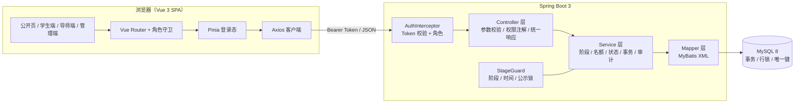
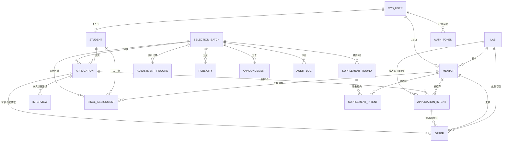
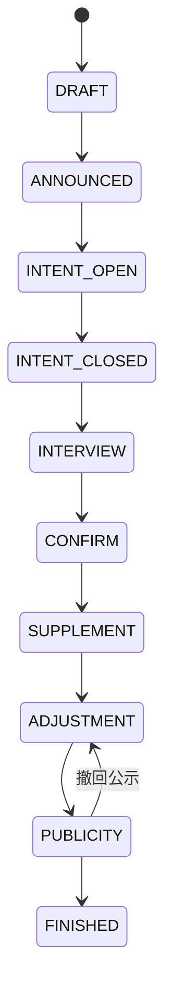
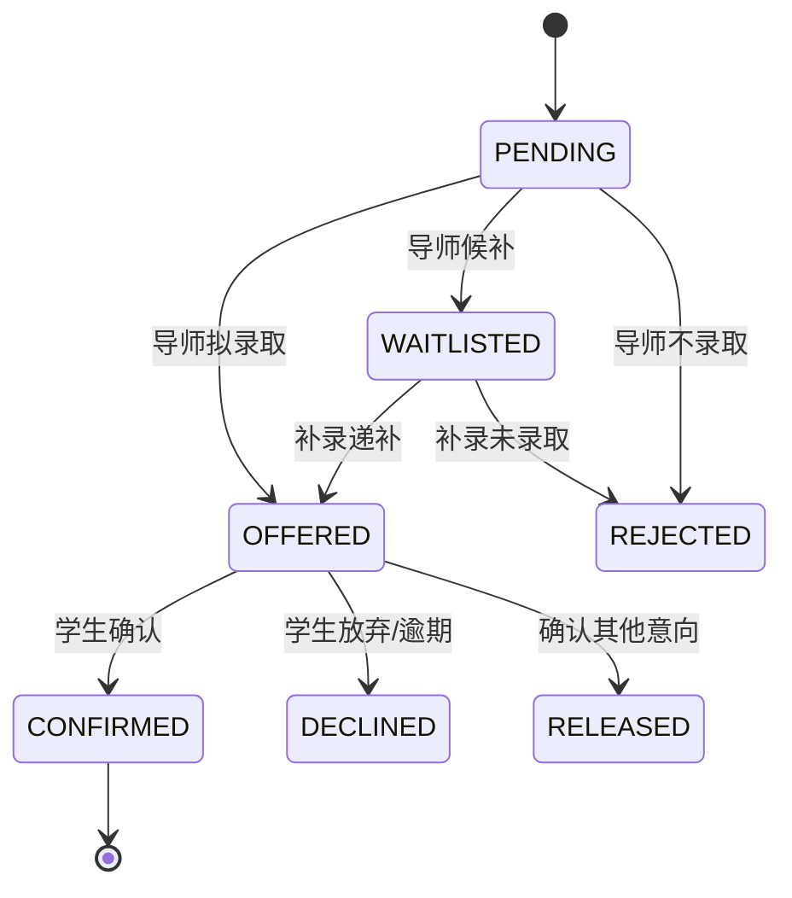
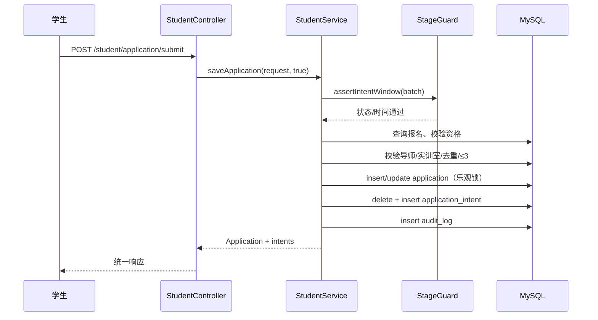

# 系统设计与数据模型

## 1. 总体架构



分层职责：

| 层 | 职责 | 不做什么 |
| --- | --- | --- |
| Controller | 路由、参数校验、角色注解、统一响应 | 不写业务规则、不直接操作 Mapper |
| Service | 阶段与时间校验、资格、名额、状态机、事务、审计 | 不处理 HTTP 细节 |
| Mapper | SQL 与结果映射 | 不写业务判断 |
| StageGuard | 阶段/时间/公示锁的统一校验 | 不承担具体业务 |
| AuthInterceptor | Token → CurrentUser、角色校验 | 不查业务数据归属（由 Service 校验） |

## 2. 核心数据模型



### 2.1 主要表说明

| 表 | 作用 | 关键约束 |
| --- | --- | --- |
| `sys_user` | 学生/导师/管理员账号 | `account` 唯一 |
| `student` | 学号、姓名、专业、班级、年级 | `student_no` 唯一；`user_id` 唯一 |
| `mentor` | 导师、职称、所属实训室、名额 | `mentor_no` 唯一；`user_id` 唯一 |
| `lab` | 实训室介绍、方向、培养、总名额 | `code` 唯一 |
| `selection_batch` | 批次、阶段、8 个阶段时间 | 一个进行中批次（业务约定） |
| `application` | 报名表、调剂意愿、拒绝实训室、乐观锁 | `(batch_id, student_id)` 唯一；`version` |
| `application_intent` | 最多 3 个平行意向 | `(application_id, mentor_id)`、`(application_id, sort_no)` 唯一 |
| `interview` | 实训室统一面试 | `(application_id, lab_id)` 唯一 |
| `offer` | 拟录取/候补递补/补录拟录取 | 状态机；可多个待确认 |
| `final_assignment` | 最终录取 | `(batch_id, student_id)` 唯一 |
| `supplement_round` | 补录轮次 1—3 | `(batch_id, round_no)` 唯一 |
| `supplement_intent` | 补录意向 | `(round_id, student_id, mentor_id)` 唯一 |
| `adjustment_record` | 内部/跨室/谈话 | 记录原去向、新去向、原因、操作人 |
| `publicity` | 公示草稿/公示中/结束/撤回 | 一次批次多次公示，取最新有效 |
| `announcement` | 宣讲/开放日/面试/补录/公示通知 | 发布状态 + 展示时间 |
| `audit_log` | 全流程操作留痕 | 操作人、角色、对象、原因、IP |
| `auth_token` | 不透明登录令牌 | `token_hash` 唯一；有效期 |

### 2.2 为什么把“意向”和“拟录取”分开

- `application_intent` 记录学生“想选谁”，状态是 **学生视角 + 导师初选结论**；
- `offer` 记录“谁向学生发出了什么”，状态是 **录取流程视角**（待确认/已确认/放弃/释放/逾期）；
- `final_assignment` 记录“最后去了哪里”，保证一人一组。

三者分离后，以下场景可以自然表达：

- 学生同时有 2 个拟录取，确认一个，另一个变为 `RELEASED`；
- 导师先给候补，补录时按顺位转为拟录取；
- 补录阶段重新填报，不覆盖首轮意向；
- 调剂绕过“拟录取”，直接产生最终录取并保留调剂记录。

## 3. 状态机

### 3.1 批次阶段



管理员允许在同一页面切换任意阶段（便于演示与应急），但以下规则会阻止非法操作：

- 公示已发布/已结束时，除“公示”和“完成”外，其他阶段切换会被拒绝；
- 进入确认阶段自动确认唯一拟录取；
- 进入补录阶段自动准备第一轮；
- 进入公示阶段尝试生成公示草稿；
- 公示结束自动锁定最终结果并将批次置为完成。

### 3.2 意向状态



### 3.3 拟录取状态

```text
OFFERED（待确认）
  ├── CONFIRMED（已确认，生成 final_assignment）
  ├── DECLINED（学生主动放弃）
  ├── EXPIRED（逾期，管理员/定时任务处理）
  └── RELEASED（确认其他意向后自动释放）
```

## 4. 关键流程

### 4.1 意向填报



### 4.2 拟录取与确认

1. 导师在“面试与初选”阶段录入面试（评分、评语、通过/不通过）；
2. 导师提交 `OFFER / WAITLIST / REJECT`；
3. `OFFER` 时锁定导师和实训室行，计算 `max(active offers, final assignments)`，校验名额；
4. 进入确认阶段时，系统自动确认“仅 1 个拟录取”的学生；
5. 多个拟录取的学生自主选择，确认一个后其他 `OFFERED` 变 `RELEASED`，对应意向释放；
6. 最终写入 `final_assignment`，唯一键保证一人一组。

### 4.3 补录与递补

1. 进入补录阶段，自动创建第 1 轮；
2. 管理员开放轮次；
3. “执行候补递补”按 `waitlist_rank` 顺序把候补转为拟录取，受名额限制；
4. 未录取学生可重新填报最多 3 个补录意向；
5. 导师在补录阶段提交拟录取/候补/不录取；
6. 学生确认补录拟录取；
7. 结束轮次时，本轮仍待确认的拟录取自动标记逾期并释放。

### 4.4 统筹调剂

```text
未录取学生
  ├─ 不接受调剂 → 谈话安置记录
  ├─ 仅内部调剂 → 只在本人填报过的实训室内找余额
  └─ 接受跨室调剂
       ├─ 第一优先级：本人填报过的实训室内部
       ├─ 第二优先级：其他仍有余额的实训室
       └─ 仍无余额 → 谈话安置记录
```

约束：

- 必须在“统筹调剂”阶段；
- 学生必须授权对应类型；
- 不分配到 `excluded_lab_ids` 中明确拒绝的实训室；
- 导师与实训室名额仍需锁定校验；
- 写入 `adjustment_record` 与 `audit_log`。

## 5. 并发与一致性

| 风险 | 措施 |
| --- | --- |
| 两个导师同时给学生发拟录取导致超额 | `SELECT … FOR UPDATE` 锁定 `mentor` 与 `lab` 行；在同一事务内计数并插入 |
| 学生同时确认两个拟录取 | `final_assignment(batch_id, student_id)` 唯一键 + 事务内先查后插 + 捕获唯一键冲突 |
| 学生重复提交/覆盖他人修改 | `application.version` 乐观锁；`UPDATE … WHERE id=? AND version=?`，影响 0 行返回 409 |
| 重复意向 | `(application_id, mentor_id)` 唯一键；Service 先去重 |
| 同一学生同时加入多个实训室 | `final_assignment` 唯一键 |
| 补录轮次重复 | `(batch_id, round_no)` 唯一键 |
| 公示后被修改 | `StageGuard.assertNotLocked` + 前端禁用按钮；撤回公示才解锁 |
| 阶段重复推进产生重复数据 | 自动确认/建轮次前做存在性判断；阶段切换幂等 |

## 6. 鉴权与安全

- 口令：`PBKDF2WithHmacSHA256`，120,000 次迭代，随机 16 字节盐，输出 `pbkdf2$iterations$salt$hash`；
- Token：32 字节安全随机数，Base64URL；服务端只存 SHA-256 摘要，可撤销、可过期；
- 角色：`STUDENT` / `MENTOR` / `ADMIN`，通过 `@RequireRole` + 拦截器控制；
- 数据权限：Service 内校验“当前学生/导师是否拥有该记录”，导师端主动屏蔽其他平行意向；
- 审计：所有关键写操作记录操作人、角色、对象、原因、IP；
- 不返回 `password_hash`、`token_hash` 等敏感字段。

## 7. 时间窗口与演示模式

- `StageGuard` 同时支持“阶段校验”和“时间校验”；
- 阶段校验始终生效；
- 时间校验由 `app.enforce-time-window` 控制：
  - `false`（默认，演示）：允许管理员在同一天手动推进全部阶段；
  - `true`（生产）：超出阶段起止时间的操作返回 `40011`；
- `SelectionScheduler` 在时间校验开启时，定时处理逾期拟录取与到期的补录轮次；演示模式不自动执行，便于讲解。

## 8. 前端设计

- `AppShell`：侧边栏 + 顶栏 + 角色导航，移动端自动折叠为横向导航；
- `router`：路由级角色守卫，未登录跳登录，角色不符跳各自首页；
- `stores/auth`：Token/用户持久化到 localStorage，401 自动清理并跳登录；
- `api/client`：统一 `baseURL=/api`、Bearer 注入、业务码/HTTP 错误归一化；
- 复用组件：`StatusPill`、`StatCard`、`StepFlow`、`MentorPicker`、`ModalDialog`、`EmptyState`、`ToastHost`；
- 视觉：参考河北师范大学官网的深蓝 + 白色配色，深蓝侧栏 / 导航、浅蓝灰背景、白色卡片与柔和阴影；
- 所有业务数据来自后端接口，无写死业务数据。

## 9. 目录与代码组织

```text
backend/
  auth/        TokenService、PasswordService、AuthInterceptor、AuthContext
  common/      ApiResponse、PageResult、ErrorCode、GlobalExceptionHandler
  config/      WebConfig（拦截器/CORS）、JacksonConfig
  controller/  Auth、Public、Student、Mentor、Admin、Health
  domain/      entity（表映射）、enums（状态枚举 + 中文 label）
  dto/         Login、ApplicationSave、Interview、Decision、Supplement、Adjustment 等
  mapper/      MyBatis 接口 + resources/mapper/*.xml
  service/     StageGuard、SelectionService、StudentService、MentorService、
               SupplementService、AdjustmentService、PublicityService、
               AdminService、CatalogService、AuditService、Scheduler
```

## 10. 已知取舍

- 演示数据初始化使用 `INSERT IGNORE`，重复启动不会重复插入；修改种子数据后需要重建数据库才能完全生效；
- 生产环境应关闭演示数据初始化（可将 `spring.sql.init.mode` 改为 `never`，或使用独立 migration）；
- 补录阶段的面试沿用首轮面试记录或由导师线下考核，系统未强制补录重新面试（可在 `MentorService.decideSupplement` 中追加校验）；
- 没有实现 Excel 导入导出、短信/邮件通知、统一身份认证，这些均在大纲“不做”范围内。
